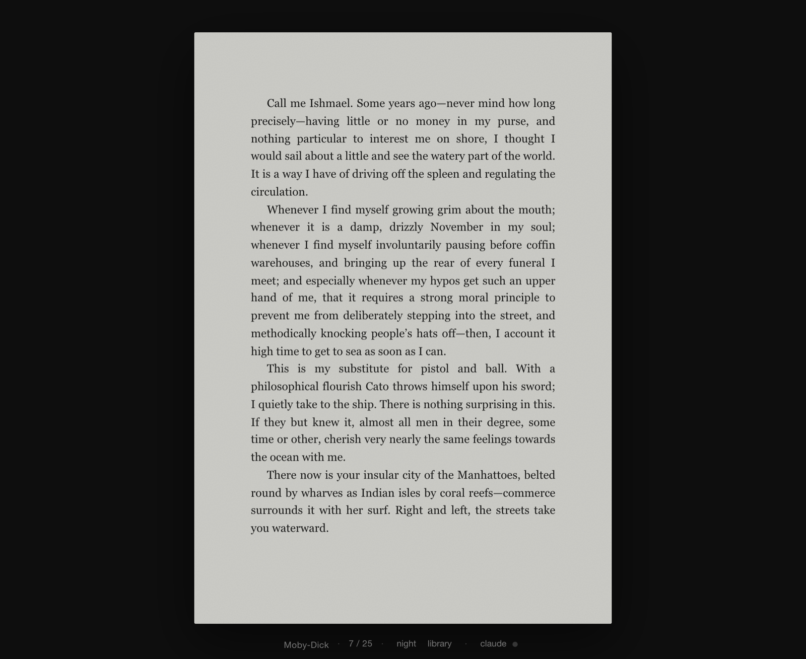
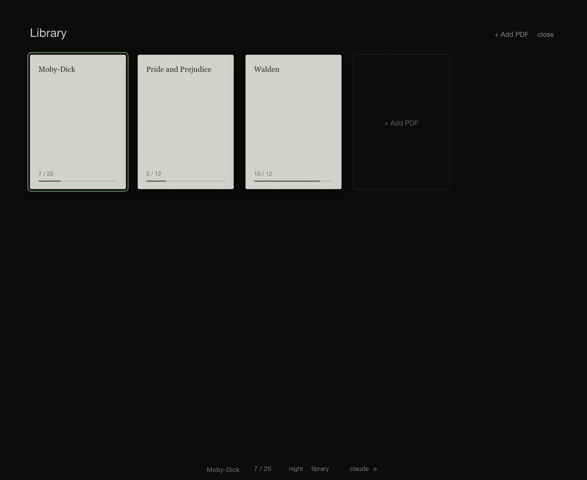

# Claude Reading Break

A small PDF reader for macOS that turns the time you spend waiting on Claude Code into reading time.

You send a prompt, your book comes to the front. Claude finishes, you are back in Claude. That is the whole idea.



## What it does

- **Opens itself while Claude works.** When you press Enter on a prompt, the reader comes to the front.
- **Steps aside when the answer is ready.** When Claude finishes, Claude comes back to the front.
- **Looks like an e-reader.** Dark surroundings, a matte gray page, no glare. There is also a night mode.
- **Remembers your books.** Every PDF you add stays in a built-in library and reopens on the page you left.
- **Stays local.** No account, no network, no tracking.



## Install

You need macOS, [Node.js](https://nodejs.org) 20 or newer, and [Claude Code](https://claude.com/claude-code).

### 1. Build the app

```bash
git clone https://github.com/tahaxerel/claude-reading-break.git
cd claude-reading-break
npm install
npm run build
```

### 2. Move it to Applications

```bash
cp -R dist/Reader-darwin-*/Reader.app /Applications/
```

### 3. Connect it to Claude Code

Open `~/.claude/settings.json` and add this `hooks` block. If the file already has other settings, keep them and add `hooks` next to them.

```json
{
  "hooks": {
    "UserPromptSubmit": [
      {
        "hooks": [
          {
            "type": "command",
            "command": "[ -e \"$HOME/.ereader/claude-off\" ] || open -a /Applications/Reader.app",
            "async": true
          }
        ]
      }
    ],
    "Stop": [
      {
        "hooks": [
          {
            "type": "command",
            "command": "[ -e \"$HOME/.ereader/claude-off\" ] || open -a Claude",
            "async": true
          }
        ]
      }
    ]
  }
}
```

The second command brings the Claude desktop app back. If you use Claude Code in a terminal, replace `Claude` with the name of your terminal app, for example `Terminal`, `iTerm`, or `Ghostty`.

Start a new Claude Code session and you are done. Open Reader once, drop a PDF on it, and send a prompt.

## Using the reader

| Action | How |
| --- | --- |
| Add a book | Drop a PDF on the window, or press `⌘O` |
| Next page | `→`, `Space`, scroll down, or click the right edge |
| Previous page | `←`, scroll up, or click the left edge |
| Open the library | `L` or `⌘L` |
| Close the library | `Esc` |
| Paper / night mode | `T` |
| First / last page | `Home` / `End` |

The bar at the bottom shows the book title and page number. It appears when you move the mouse.

## Turning it off for a while

Click **claude** in the bottom bar. A green dot means the link is on. When the dot is gray, sending prompts no longer switches windows, and the reader works as a normal PDF reader. Click again to turn it back on. You never have to edit the settings file.

## Where your data lives

| What | Where |
| --- | --- |
| Your books and reading positions | `~/Library/Application Support/ereader/` |
| The on/off switch | `~/.ereader/claude-off` (exists only while the link is off) |

Books are copied into the library when you add them, so you can move or delete the original files.

## Uninstall

1. Remove the `hooks` block from `~/.claude/settings.json`.
2. Delete `/Applications/Reader.app`.
3. Delete the two locations listed above if you also want to remove your library.

## Development

```bash
npm start
```

This runs the app straight from the source. The code is small:

- `main.js` is the window, the library storage, and the on/off switch.
- `app/renderer.js` draws pages with [PDF.js](https://mozilla.github.io/pdf.js/) and handles the keyboard.
- `app/styles.css` is the e-ink look.
